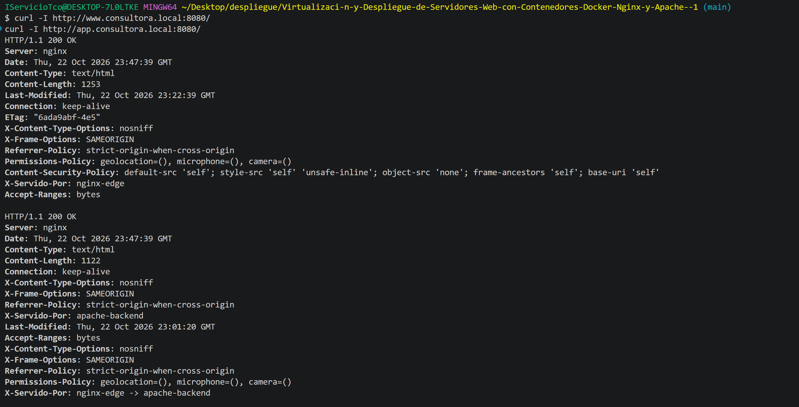

# Virtualizacion-y-Despliegue-de-Servidores-Web-con-Contenedores-Docker-Nginx-y-Apache-

Archivos del proyecto
.
├── docker-compose.yml # Levanta los dos contenedores y crea las redes
├── .gitignore # Para que los logs no suban al repo
├── .gitattributes # Fuerza finales de linea LF (trabajo en Windows)
├── README.md
│
├── nginx/
│ ├── conf.d/
│ │ ├── 00-hardening.conf # Ajustes de seguridad generales
│ │ └── default.conf # Los dos dominios y el proxy inverso
│ ├── html/
│ │ ├── index.html
│ │ └── estilos.css
│ └── logs/
│
└── apache/
├── Dockerfile # Enciende solo los modulos que necesito
├── conf/
│ ├── hardening-base.conf # Ajustes de seguridad generales
│ └── sitio-privado.conf # El sitio, /privado/ y los logs
├── html/
│ ├── index.html
│ ├── estilos.css
│ └── privado/
│ └── index.html
└── logs/

    He llamado al archivo 00-hardening.conf porque Nginx carga los archivos de conf.d por orden alfabético y en ese archivo defino el map y los formatos de log que luego uso en default.conf, y si se cargara después no arrancaria, con el 00- me aseguro de que va primero.

Apache tiene Dockerfile y Nginx no porque a apache tengo que activarle módulos que vienen apagados en la imagen oficial, eso hay que hacerlo construyendo la imagen. Nginx me vale tal cual viene, solo le monto la configuración.

Para desplegarlo lo que he usado es:

Windows 11 con Docker Desktop, Git y un editor.

1. Los dominios

Los dos dominios me los he inventado, no existen en internet, así que hay que decirle al ordenador a dónde apuntan. Abro PowerShell como administrador y ejecuto:

powershell:
Add-Content -Path C:\Windows\System32\drivers\etc\hosts -Value "`n127.0.0.1`twww.consultora.local`n127.0.0.1`tapp.consultora.local" ipconfig /flushdns

Esto añade dos líneas al archivo hosts, que es una lista que mira Windows antes de preguntar a ningún DNS.

Si no se puede tocar ese archivo (por permisos del equipo), se puede saltar este paso y usar curl --resolve en las pruebas, que manda la misma cabecera Host y funciona igual.

2. Levantarlo
   bash
   git clone <url-del-repo>
   cd <carpeta-del-repo>

docker compose config --quiet # comprueba que el compose no tiene errores
docker compose up -d --build # construye Apache y levanta todo
docker compose ps # ver que los dos estan healthy 3. Comandos del día a día
bash
docker compose logs -f nginx-edge # ver los logs en directo
docker compose restart nginx-edge # reiniciar uno
docker compose down # parar y borrar los contenedores
docker compose down -v --rmi local # borrar tambien imagenes y volumenes
Comprobar que funciona
Los dos dominios responden, y cada uno por su servidor
bash
curl -I http://www.consultora.local:8080/
curl -I http://app.consultora.local:8080/

